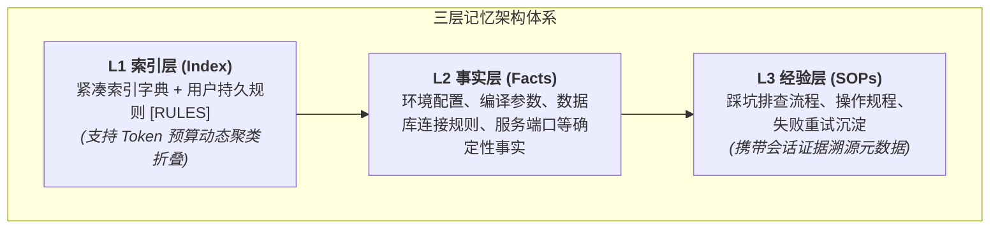

简体中文 | [English](README.en.md)

# dsh-layered-memory

**DeepSeek Harness (DSH) 的三层结构跨会话长期记忆扩展**。

普通智能体在会话关闭的瞬间就会丢失全部上下文。再次打开项目时，开发者往往需要重复解释运行环境、编译指令与历史踩坑经验。`dsh-layered-memory` 通过纯本地 Markdown/JSON 文件系统实现可读、可追溯且无依赖的跨会话记忆引擎，支持多命名空间隔离、BM25 快速检索、版本回滚与自动化记忆维护。

---

## 核心设计：三层记忆架构



* **L1 紧凑索引（Index）**：会话启动时默认注入的高频轻量清单，包含核心工作流规则。当超出字符预算时，自动聚类折叠二级条目。
* **L2 确定性事实（Facts）**：存储项目技术栈、特殊参数与环境事实，消除重复沟通。
* **L3 任务经验库（SOPs）**：沉淀多步排查方案与成功经验，每条记录携带对应会话轮次的证据引用与元数据。

---

## 关键技术亮点

* **零外部数据库依赖**：全部数据以结构化 Markdown 与 JSON 文件保存在 `~/.dsh/memory/` 下。无需向量数据库或嵌入模型服务，普通文本编辑器即可手改、备份或纳入 Git 管理。
* **BM25 极速全文本检索**：原生内置 BM25 词频评分算法，跨越事实库、SOP 库与历史归档秒级召回关联条目。
* **动态命名空间与分支感知**：根据当前项目路径与 Git 分支自动推断独立命名空间（如 `repo-main`、`repo-feature`），实现多项目与多开发分支环境互不干扰。
* **渐进式工具注入（Progressive Disclosure）**：默认仅向模型暴露核心入口；模型确认需要读取或管理记忆时才动态激活完整 14 个细粒度工具，节约常规对话的工具定义开销。
* **安全审计与凭据脱敏**：写入记忆时严格审查明文敏感信息（API Key、Token、私钥），发现明文机密立即拒绝入库，证据引用中的敏感片段自动打码脱敏。
* **不可变快照与回滚机制**：任何条目的修改和覆盖自动保留 `.history/` 时间戳快照，支持随时一键回滚。

---

## 记忆工具矩阵

| 工具分类 | 工具名称 | 职责定位 |
| :--- | :--- | :--- |
| **检索与阅读** | `memory_list` | 列出当前命名空间下各层记忆、待审候选及预算使用情况 |
| | `memory_read` | 读取指定词条，支持大文件行级切片与大纲透视 |
| | `memory_search` | 基于 BM25 全文检索事实、经验库及归档记录 |
| **写入与迭代** | `memory_write` | 新增事实或 SOP 经验，强制关联证据并脱敏敏感信息 |
| | `memory_update` | 更新词条，同步更新溯源并自动创建历史快照 |
| | `memory_rollback` | 一键回滚指定词条至上一版本快照 |
| **生命周期** | `memory_archive` | 归档低频条目（从 L1 隐藏但保留可检索性） |
| | `memory_pending` | 查看运行中从重试序列提炼出的待定候选经验 |
| | `memory_accept` | 将待定候选经验审核晋升为正式 L3 SOP |
| | `memory_promote` | 将项目私有经验晋升至全局通用命名空间 |
| **治理与审计** | `memory_index` | 重新生成并校验 L1 索引，保留手动 `[RULES]` 规则区 |
| | `memory_maintain` | 合并同名重复节、排查相似度冲突、清理冷数据 |
| | `memory_stats` | 输出记忆库条目数、存储占用与生命周期状态统计 |

---

## 安装与快速上手

```bash
# 通过 DSH 插件管理器安装
dsh plugin --profile web add github:DDDFXYqiming/dsh-layered-memory
```

本地开发：
```bash
git clone https://github.com/DDDFXYqiming/dsh-layered-memory.git
cd dsh-layered-memory
npm install && npm run build
dsh plugin --profile web add .
```

---

## 配置指南

可在当前 Profile 的 `cordis.patch.yml` 中调整记忆策略：

```yaml
- id: dsh-layered-memory
  config:
    memoryDir: ''              # 存储主目录（默认为 ~/.dsh/memory）
    l1MaxChars: 12288         # L1 索引的最大字符预算
    progressive: true          # 是否启用渐进式工具加载以减少日常上下文开销
    autoNamespace: true        # 是否基于项目工作区与 Git 分支自动隔离命名空间
    autoPending: false         # 是否自动将失败重试序列提炼为待定经验候选
    maintainEveryTurns: 20     # 每隔 N 轮自动执行轻量级维护与冗余检查
    nearDupeThreshold: 0.85    # Jaccard 相似度疑似重复检测阈值
    heatHalfLifeDays: 14       # 记忆访问热度衰减半衰期（天）
    recencyWindowDays: 7       # 新建词条的保护期（天）
```

---

## 许可证

本项目基于 [MIT License](LICENSE) 开源。
