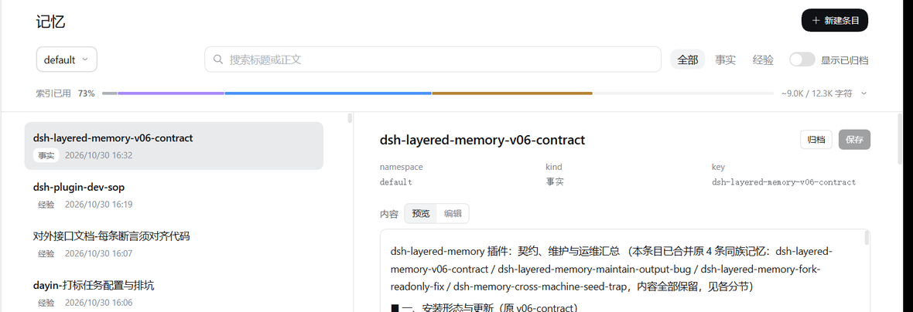

# @dsh-external/dsh-layered-memory

English | [中文](README.zh.md)

## Summary

Layered memory carries facts and operating procedures from one session into the next. Facts live under second-level headings in `facts.md`, procedures in `sops/*.md`; entries are addressed by `{namespace, kind, key}`, carry evidence, and keep the previous version before a write, so history can be reviewed and rolled back.

## Table of Contents

- [Install](#install)
- [Use](#use)
- [Memory Management Page](#memory-management-page)
- [Configuration](#configuration)
- [Further Exploration](#further-exploration)
- [Known Limitations and Deferred Work](#known-limitations-and-deferred-work)

## Install

```bash
dsh plugin --profile web add   github:DDDFXYqiming/dsh-layered-memory   "github:DDDFXYqiming/dsh-layered-memory#path:/lib/status"
```

Both specifiers are required because the bundle contributes two components: the memory plugin and the input-area status service. pnpm blocks exotic subdependencies, so the status package has to be declared as a direct dependency or a fresh install only gets the first component.

Desktop runs the same install through its bundled `dsh` command with the `desktop` profile. For local development, run `npm run build`, link the repository and `lib/status`, and point the profile at them.

## Use

The basic `memory_search/list/read/write/update` tools are available in each session. Load the `memory` skill or call `memory_activate({mode:"common"})` to add the status and conflict tools; management operations use `mode:"manage"`. User configuration controls access through `memoryAccess` and `subagentMemoryAccess`, with child agents read-only by default.

Entries are addressed by the `entry` object returned from search, list or create. Reuse that object instead of rebuilding it from a title.

```js
memory_write({
  namespace: "my-project",
  kind: "fact",
  topic: "Preview command",
  content: "Run pnpm dev to start the preview.",
  evidence: "The command started successfully and the page loaded."
})
// Reuse the returned entry for later calls.
memory_read({entry, full: true})
memory_update({entry, content: "A revised finding", evidence: "New verification"})
memory_activate({mode: "manage"})
memory_history({entry})
memory_rollback({entry, snapshot_id: "Choose a returned snapshot id"})
```

| Task | Tools |
| --- | --- |
| Find and read | memory_search, memory_list, memory_read |
| Create and update | memory_write, memory_update |
| Inspect evidence | memory_expand |
| Restore history | memory_history, memory_rollback |
| Archive and restore visibility | memory_archive |
| Share and migrate | memory_promote, memory_namespace |
| Process candidates | memory_pending, memory_accept, memory_discard |
| Inspect and maintain | memory_stats, memory_index, memory_maintain, memory_review |

Search covers active entries in the current and global spaces. Pass `include_archived:true` to reach archived content, then read the returned entry. A read reports its line range, total lines, revision, completeness and the next line offset. Global rules and complete indexes remain readable through the `rules`, `index` and `policy` entry kinds.

## Memory Management Page

The Web sidebar carries a “Memory” entry that opens a standalone page: the entry list on the left, the detail on the right. Search, filter by type, show archived entries, edit content and evidence in place, archive and restore, and review history snapshots with a rollback. Interface text follows the host language, and entry types show as Fact/Skill or 事实/经验 depending on it. The data channel and the page rules live in the [memory page contract](docs/memory-browser-contract.md).



The “Index used” line under the toolbar reports how much of the L1 index is taken and how many characters are used against the budget. Expanding it breaks the index into header, rules, facts and skills; hovering a section explains what it holds and how much it takes.


The bundle also ships a separate Memory status component. Its line at the bottom of the Web composer shows the current session's review progress, the number of real changes or the reason the last run did not finish; clicking it opens run records and read-only history.


## Configuration

```yaml
- id: dsh-layered-memory
  config:
    defaultNamespace: ''
    autoNamespace: true
    progressive: true
    l1MaxChars: 12288
    globalL1MaxChars: 2048
    indexTargetRatio: 0.9
    memoryAccess: write
    subagentMemoryAccess: read
    autoPending: false
    turnReviewEnabled: true
    turnReviewMinEvidence: 6
    turnReviewReasoningEffort: ''
    maintenanceMaxTokens: 16384
    maintenanceMaxCalls: 64
    maintenanceMaxWrites: 6
    maintenanceTimeoutSeconds: 300
    maintenanceCooldownMinutes: 30
    reflectionMode: notify
```

Automatic namespaces come from the workspace identity or the canonical root path; branches of one repository share the project memory and existing namespaces have to be migrated explicitly. `default` is the global space, included in project indexes and default searches. Character budgets cover index entries and manual rules together, and the full files stay readable through the tools.

The main agent reads and updates notes during its task while a background review checks the relevant notes for omissions, contradictions and duplication. End-of-turn review is on by default, batch maintenance runs under `reflectionMode: auto`, and index pressure work targets a watermark: the target character count is `l1MaxChars` × `indexTargetRatio`. Scheduling, budgets and checkpoints are covered in [automatic maintenance](docs/automatic-maintenance.zh.md).

## Further Exploration

- [Design notes](docs/design.md) cover storage, identity, context assembly and how index usage is measured.
- [Development and end-to-end acceptance](docs/development.md) covers building, loading a real host and verifying a change.
- [Automatic maintenance](docs/automatic-maintenance.zh.md) covers the scheduling of end-of-turn review, batch maintenance and index pressure work.
- [Memory page contract](docs/memory-browser-contract.md) covers the data channel, the index usage component and the page rules.
- [Heat ranking contract](docs/heat-ranking-contract.md) covers heat scoring, ranking snapshots and the hard constraints around them.
- [Changelog](CHANGELOG.md) records released behavior.

## Known Limitations and Deferred Work

- **Index folding hides detail**, when an index exceeds its character budget, entries are folded and descriptions are trimmed. The full body stays available through `memory_read`.
- **The index is a fixed per-session cost**, the project index is bounded by `l1MaxChars` and the global one by `globalL1MaxChars`, and over budget the hottest entries come first. The index sits in a stable prefix, so a write that changes it invalidates the cached tokens after it. See the [design notes](docs/design.md).
- **Maintenance spends model calls**, internal end-of-turn reviews and `reflectionMode: auto` runs invoke subagents. Budgets apply per maintenance run rather than per session.
- **Namespace identity is path based**, moving a project to another path creates a different namespace until it is migrated explicitly.
- **Tool access is per session**, basic memory tools come with the session and the memory skill or `memory_activate` adds the optional ones. Historical activation restores the tool mode only.
- **Usage numbers are per namespace**, the usage line measures the selected namespace only and never combines the `default` and project spaces.
- **Budget overflow only affects the prompt view**, the on-disk `index.txt` always holds the full active directory. Going over budget neither deletes nor archives entries; it only trims the view injected into the prompt.

### Dev Note

None.
